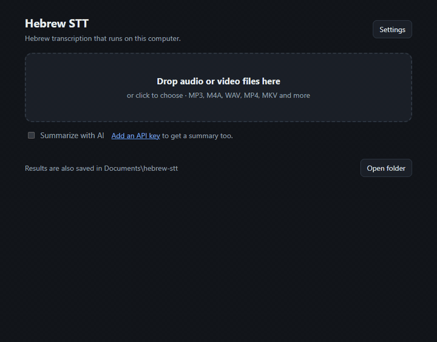

# hebrew-stt

Transcribe Hebrew (or English) audio and video on your own computer, with an optional AI summary.



- **Local transcription** with [faster-whisper](https://github.com/SYSTRAN/faster-whisper): Hebrew with Whisper fine-tuned by [ivrit-ai](https://huggingface.co/ivrit-ai) (`ivrit-ai/whisper-large-v3-turbo-ct2`), English with [distil-whisper](https://huggingface.co/distil-whisper/distil-large-v3.5-ct2) (`distil-large-v3.5`, English-only, about as accurate as Whisper large-v3 and much faster).
- **Names and terms**: list the lecturer's name or course terms and they are recognized and spelled better.
- **Any computer**: uses an NVIDIA GPU when available, otherwise the CPU. Windows, macOS and Linux.
- **A simple page in your browser**: drop files, follow the progress (or stop a file), read, copy or download the result. Click a line to **listen from that moment** while the text follows along. Earlier results are listed too. A **command line** does the same thing.
- **Subtitles**: every result also comes as an `.srt` file for a video player.
- **Optional AI** through any OpenAI-compatible API (DeepSeek by default): summaries in the style you pick (very short, lecture notes, meeting, phone call, chapters with times, study questions and more), and **questions about a recording** answered from its transcript. Without an API key, nothing leaves your computer.

## Quick start

You need Python 3.10 or newer.

```bash
pipx install git+https://github.com/dav2I/hebrew-stt
```

```bash
hebrew-stt
```

That opens hebrew-stt in your browser. Pick the language, drop audio or video files on the page, and the transcript appears when it is ready. Keep the terminal window open while you use the page; press Ctrl+C there to stop.

Or use the command line:

```bash
hebrew-stt lecture.mp3 meeting.m4a
```

The first time you use a language, its model is downloaded from Hugging Face (about 1.6 GB for Hebrew, 1.5 GB for English). After that it works offline. For English recordings add `-l en`.

No pipx? `pip install git+https://github.com/dav2I/hebrew-stt` works too, or from a clone: `pip install -e .`

To try it on the included sample (a 40-second Hebrew reading, see [examples](examples/)), run this from a clone:

```bash
hebrew-stt examples/sample.mp3
```

### Faster with an NVIDIA GPU (optional)

```bash
pipx install "hebrew-stt[cuda] @ git+https://github.com/dav2I/hebrew-stt"
```

This adds the CUDA 12 libraries (cuBLAS, cuDNN 9) from pip. On Windows they are found automatically. On Linux, either install CUDA 12 and cuDNN 9 system-wide or add the pip packages to `LD_LIBRARY_PATH` ([details](https://github.com/SYSTRAN/faster-whisper#gpu)). If no usable GPU is found, hebrew-stt says so and uses the CPU, which is slower but gives the same result. On macOS it always uses the CPU.

## Usage

```
hebrew-stt [FILE_OR_FOLDER ...] [-l he|en] [--terms TEXT] [--style STYLE] [--no-summary]
           [-o DIR] [--device auto|cuda|cpu] [--model NAME]
```

| Option | What it does |
|---|---|
| *(no files)* | Opens the page in your browser |
| `FILE_OR_FOLDER` | Audio/video files, or folders containing them |
| `-l, --language` | `he` (Hebrew, default) or `en` (English) |
| `--terms` | Names and words that appear in the recordings, e.g. `"Dr. Cohen, Dijkstra"` |
| `--style` | Summary style (see [AI](#ai-optional)), default `general` |
| `--no-summary` | Only transcribe, even if an API key is set |
| `-o, --output-dir` | Where to save results (see below) |
| `--device` | `auto` (default), `cuda` or `cpu` |
| `--model` | Another Whisper model in CTranslate2 format for the chosen language, e.g. `distil-small.en` (336 MB) for a smaller English model |

Each file produces:

| File | Content |
|---|---|
| `name.txt` | The transcript, one segment per line |
| `name_timestamps.txt` | The transcript with times: `[01:02 -> 01:05] ...` |
| `name.srt` | Subtitles for a video player |
| `name_summary.md` | The AI summary, only when enabled |

From the command line they are saved next to each input file. From the browser they are shown on the page and also saved in `Documents/hebrew-stt` (the page has an **Open folder** button), and the page lists them under **Previous results**. `-o` changes either location.

On the page, the **With timestamps** tab plays the recording from any line you click and highlights the line being played. The recording plays from your computer; for a previous result, choose the original file with **Listen along…**.

Supported formats: mp3, m4a, wav, flac, ogg, opus, aac, wma, mp4, mkv, webm, mov, avi. No separate FFmpeg install is needed.

## AI (optional)

With an API key, hebrew-stt can summarize recordings and answer questions about them. Both use only the transcript text.

**Summary styles** (`--style`, or the menu next to **Summarize with AI**):

| Style | What you get |
|---|---|
| `general` | Detects what the recording is (lecture, meeting, call, podcast...) and summarizes it to match. The default |
| `short` | One sentence and 3 to 5 key points |
| `detailed` | A full summary by topic, in order |
| `lecture` | Study notes: key concepts, definitions, examples, what the lecturer stressed, assignments and dates |
| `meeting` | Decisions, action items with owners and deadlines, open questions |
| `call` | Who called and why, what was agreed, next steps, and the dates, numbers and names that were said |
| `interview` | Main ideas, notable quotes, conclusions |
| `chapters` | Chapters with start times, like on a video |
| `quiz` | Study questions with answers |

The summary is written in the language of the recording. Long recordings are summarized in parts and then merged. On the page, the **Summary** tab can also summarize an earlier result again in another style.

**Ask** (on the page): ask questions about a recording, like "what did they decide about the budget?" The answer comes only from the transcript and points at moments like [12:34], which play the recording from there.

To turn it on, click **Settings** on the page and enter an API key. Or set these in your environment or in a `.env` file in the folder you run from (see [`.env.example`](.env.example)):

```bash
SUMMARY_API_KEY=your-key
SUMMARY_BASE_URL=https://api.deepseek.com
SUMMARY_MODEL=deepseek-flash
```

Any OpenAI-compatible chat API works. Set the base URL and model of your provider, for example `https://api.openai.com/v1`, or a local server such as Ollama at `http://localhost:11434/v1` (any non-empty key).

Where settings come from, highest priority first: environment variables, then `.env` in the current folder, then what you saved in **Settings**. The Settings file is kept only on your computer:

- Windows: `%APPDATA%\hebrew-stt\settings.env`
- macOS: `~/Library/Application Support/hebrew-stt/settings.env`
- Linux: `~/.config/hebrew-stt/settings.env`

On macOS and Linux the file is readable only by your user. The page never sends the saved key back to the browser.

## Privacy

- **Your audio never leaves your computer.** Transcription runs locally.
- The page is served only to this computer (`127.0.0.1`, port 47820 when it is free), and every request needs the random key that is in the address hebrew-stt opens. Files you drop are copied to a temporary folder for transcription and deleted afterwards. The player plays the file straight from your computer.
- The only network access is:
  1. downloading a language's model from Hugging Face the first time you use it, and
  2. if you use the summary or **Ask**, sending the **transcript text** (and your question) to the provider you configured, never the audio. Their privacy policy applies to that text.
- Your API key is stored only on your computer, in the Settings file or your own `.env`.

## Development

```bash
git clone https://github.com/dav2I/hebrew-stt
cd hebrew-stt
python -m venv .venv
```

Activate the environment (`.venv\Scripts\activate` on Windows, `source .venv/bin/activate` elsewhere), then:

```bash
pip install -e ".[dev]"
```

```bash
pytest
```

The tests need no model download and no network.

## Credits

- [ivrit-ai](https://huggingface.co/ivrit-ai) for the Hebrew Whisper models
- [distil-whisper](https://github.com/huggingface/distil-whisper) for the English model
- [faster-whisper](https://github.com/SYSTRAN/faster-whisper) and [CTranslate2](https://github.com/OpenNMT/CTranslate2)
- The sample recording is by Ariel Palmon, from Wikimedia Commons, under CC BY 3.0 ([details](examples/README.md))

## License

MIT. See [LICENSE](LICENSE). The sample recording in `examples/` keeps its own CC BY 3.0 license.
